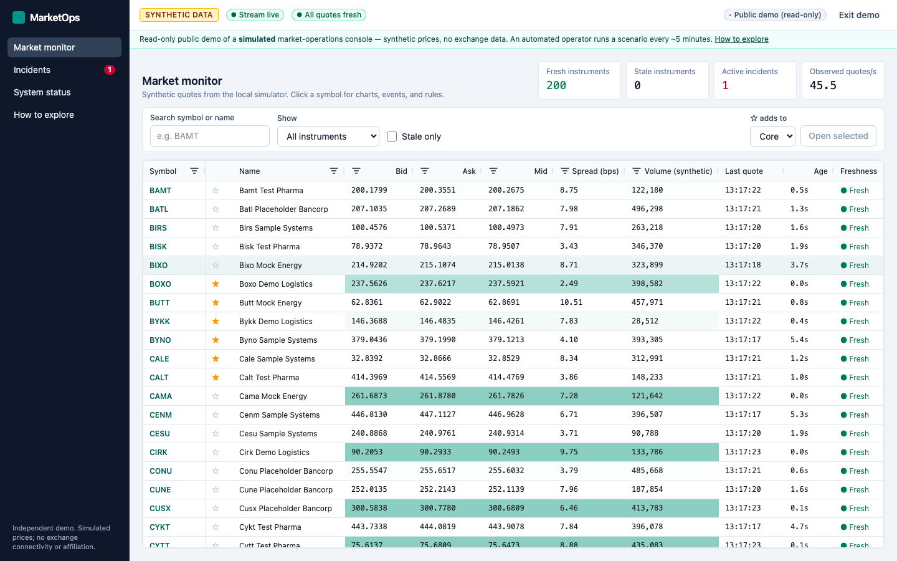
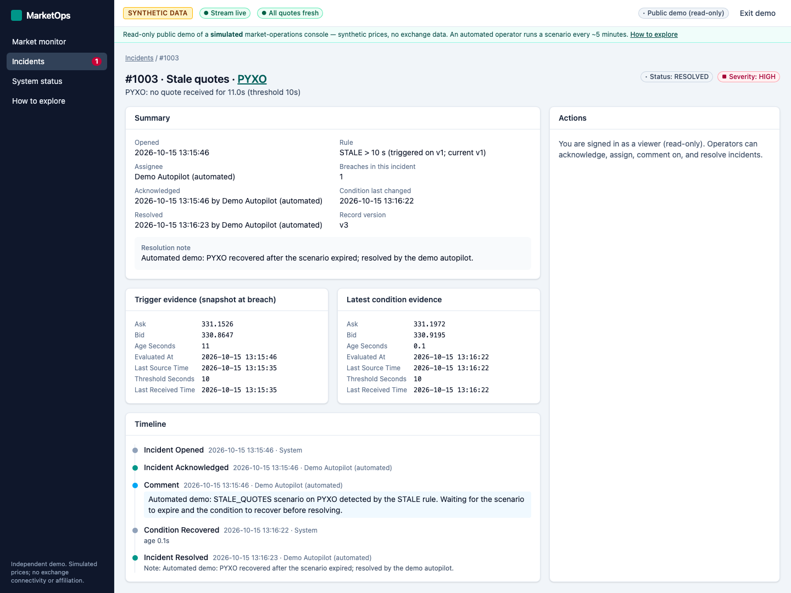
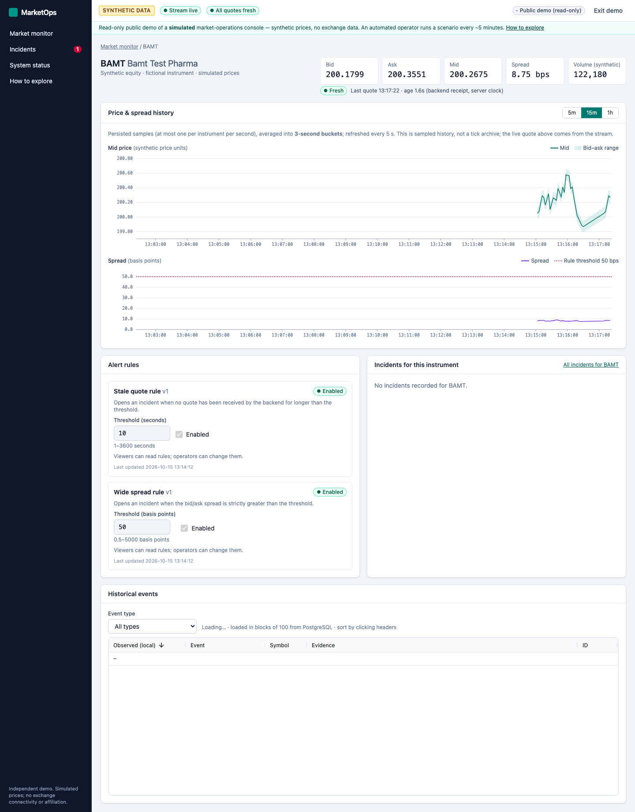
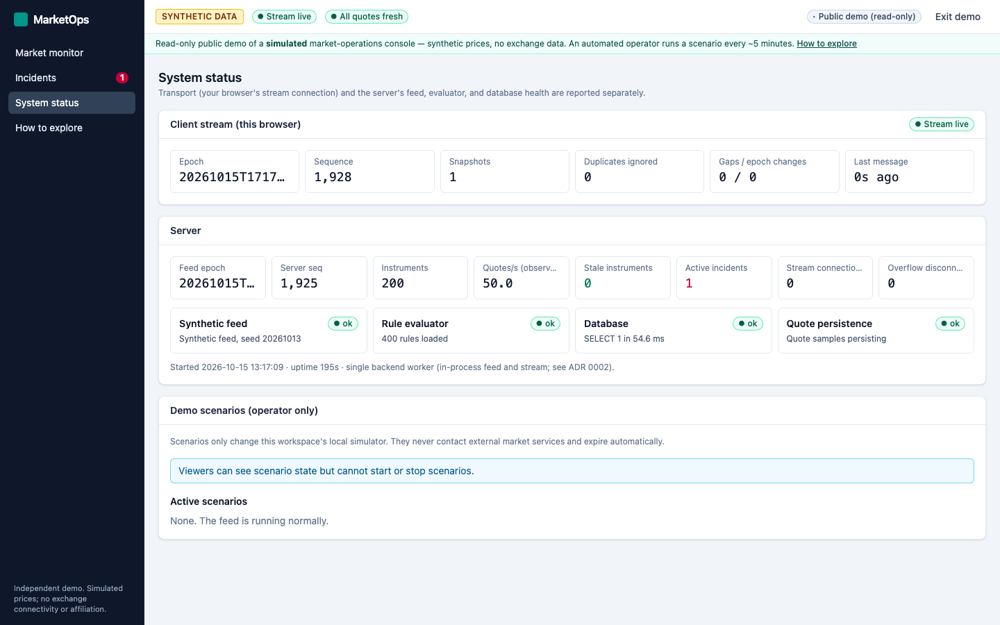
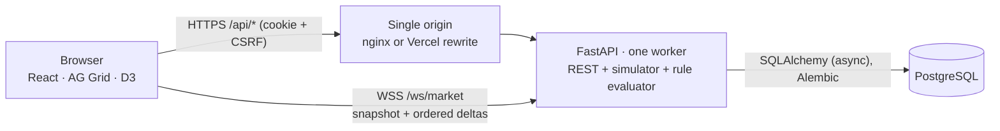

# MarketOps

[](https://github.com/gaurannggg7/MarketOps/actions/workflows/ci.yml)

**Live demo:** not deployed yet (configuration ready; see [deployment status](#deployment-status)).

Market-data monitoring and incident management for a market-operations analyst: watch quote
freshness and spreads, get an automatic incident when a feed goes stale or a spread blows out,
investigate the evidence, acknowledge, comment, and resolve once the condition recovers, with a
full audit trail.

> **Synthetic data only.** Every price, volume, and event is generated by a local, seeded
> simulator. Instruments are fictional. MarketOps is an independent portfolio project inspired by
> the engineering requirements of an ICE/NYSE full-stack posting. It is **not affiliated with ICE
> or NYSE**, does not connect to any exchange, uses no licensed market data, and is not suitable
> for trading.

## What it does
- **Market monitor**: AG Grid Community with ~50 live quote updates/s over 200 instruments,
  applied as grid transactions (no React render per tick), cell-change flashes, stable row IDs,
  a selected row that stays put while others re-sort, URL-persisted search/filters, and
  watchlists stored in PostgreSQL.
- **Instrument detail**: live quote, D3 mid/bid–ask and spread charts (5m/15m/1h, tooltips,
  keyboard navigation), a historical events grid on the Infinite Row Model (server-side blocks,
  sorting, filters), and a rule editor with unit-aware validation and version conflicts.
- **Incident workspace**: OPEN → ACKNOWLEDGED → RESOLVED with assignment, comments, evidence
  snapshots, rule versions, and a chronological audit timeline. Resolution requires an
  acknowledgment, a recovered condition, and a note; recovery never silently resolves.
- **System status**: browser transport health shown separately from server feed, evaluator,
  database, and persistence health; operator-only scenarios (stale symbol, wide spread, recovery,
  disconnect my stream) that expire automatically; demo reset with typed confirmation.

- **Public read-only demo mode**: visitors explore without an account; an automated, clearly
  labelled demo operator runs a scenario every few minutes and works the incident through the
  same audited API a human uses.

## Screenshots
Captured with Playwright from the running app (public demo session; synthetic data).

| Market monitor (live AG Grid) | Incident detail + audit timeline |
| --- | --- |
|  |  |
| **Instrument: D3 charts, rules, events** | **System status: transport vs server health** |
|  |  |

More in [docs/screenshots/](docs/screenshots) (D3 chart close-up, incident list, guide, mobile).

## Architecture

Snapshot/sequence protocol, persistence boundaries, and restart behavior:
[docs/architecture.md](docs/architecture.md). Hosting topology: [docs/deployment.md](docs/deployment.md).

## Stack
React 19 · TypeScript (strict) · Vite 8 · React Router 8 · Tailwind 4 · TanStack Query 5 ·
AG Grid Community 36 · D3 · FastAPI · Pydantic 2 · SQLAlchemy 2.1 (async) · Alembic ·
PostgreSQL 17 · pytest · Vitest + RTL · Playwright · Ruff · mypy · ESLint · Docker Compose ·
GitHub Actions. Version notes are in [ADR 0001](docs/adr/0001-stack.md).

## Prerequisites
Docker (for PostgreSQL), Python 3.13, Node ≥ 22.22 (tested with 25.2), GNU make, openssl
(TLS overlay only).

## Setup and run (local development)
```bash
make env        # creates .env with generated demo passwords (gitignored)
make db-up      # PostgreSQL 17 in Docker on 127.0.0.1:55432
make install    # backend venv from hashed lockfile + npm ci
make migrate    # alembic upgrade head
make seed       # 3 demo users, 200 synthetic instruments, default rules
make dev-backend    # terminal 1: FastAPI on :8000 (single worker)
make dev-frontend   # terminal 2: Vite on :5173, proxies /api and /ws
```
Open http://localhost:5173 and sign in as `operator@marketops.local` or
`viewer@marketops.local` with the passwords from your `.env`. Allow ~15 s of warm-up after the
backend starts before stale checks begin.

Containerized, production-style stack (nginx single origin on :8080):
```bash
make images && make stack-up && make stack-seed
MARKETOPS_URL=http://localhost:8080 make smoke
```
Do not run the dev backend and the container backend against the same database at the same time
(each runs its own simulator and evaluator).

## Tests and quality gates
```bash
make check        # ruff, mypy --strict, eslint, tsc, pytest (PostgreSQL), vitest, build
make e2e          # Playwright: 5 workflows on an isolated DB and ports (5174/8001)
make api-check    # OpenAPI → TypeScript contract drift check
make secrets-scan
```
Latest local results (2026-10-15): **62** backend tests on PostgreSQL, **84** Vitest tests,
**6** Playwright workflows in both the same-origin and the split-origin (Vercel + Render)
topology. GitHub Actions run
[38485052338](https://github.com/gaurannggg7/MarketOps/actions/runs/38485052338) passed on
commit `40a52aa` (49 / 80 / 5 at that commit). Details and gaps: [docs/testing.md](docs/testing.md).
Benchmark method and measured numbers: [docs/performance.md](docs/performance.md).

## Demo flow
Healthy feed → stale scenario on one instrument → automatic incident → inspect evidence and
charts → acknowledge and comment → recovery → resolve with a note → audit timeline. Step by step:
[docs/demo-script.md](docs/demo-script.md).

## Documentation
| Doc | Contents |
| --- | --- |
| [architecture](docs/architecture.md) | Components, snapshot/sequence protocol, persistence boundaries, restart behavior |
| [adr/](docs/adr) | Stack, single worker, sessions/CSRF, stream protocol, incident integrity |
| [api](docs/api.md) | Contract generation, error codes, conventions, versioning |
| [runbook](docs/runbook.md) | Stale feed, DB outage, dropped sockets, unhealthy deploy, restart, rollback |
| [deployment](docs/deployment.md) | Environment, proxy/WebSocket requirements, steps, smoke checks, costs to verify |
| [testing](docs/testing.md) · [performance](docs/performance.md) | Commands, fixtures, actual results, gaps |
| [production readiness](docs/production-readiness.md) · [cloud & CI/CD evidence](docs/cloud-cicd-evidence.md) · [portfolio evidence](docs/portfolio-evidence.md) | Security posture, verified runs, pending items |
| [ai-development-log](docs/ai-development-log.md) | How AI agents were used, verified, and corrected |
| [progress](docs/progress.md) · [review checklist](docs/review-checklist.md) · [CHANGELOG](CHANGELOG.md) | Status, human-review items, release notes |

## Deployment status
Not deployed. The $0/month plan (Vercel Hobby frontend, Render Free API + WebSocket, Neon Free
PostgreSQL) is configured and rehearsed locally under Render-Free-like limits (0.1 CPU / 512 MB):
[docs/deployment.md](docs/deployment.md), evidence in
[docs/cloud-cicd-evidence.md](docs/cloud-cicd-evidence.md). Free hosting sleeps after 15 minutes
without visitors; the first visit then takes about 1–2 minutes while it wakes.

## Known limitations
- **One backend worker/replica** by design (ADR 0002): feed, sequence, connections, scenarios and
  login throttling are in-process. A restart starts a new stream epoch (clients resync) and clears
  scenarios; durable records are unaffected.
- Quote history is **sampled** (≤1 row per instrument per second, 24 h retention), not a tick
  archive; samples are not backfilled after a database outage.
- One shared demo workspace; watchlists are per user, rules/incidents are shared. No multi-tenancy.
- Not deployed yet; CI has passed on GitHub for `40a52aa`, but the newest commits have not been pushed.
- No human review yet; see [docs/review-checklist.md](docs/review-checklist.md).
