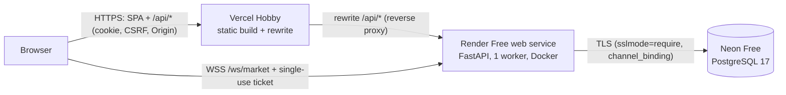

# Deployment

**Status (2026-10-15): not deployed.** Configuration is prepared and rehearsed locally. Nothing has
been pushed or provisioned for this release; both steps require the owner's explicit approval.

Primary plan: **$0/month** — Vercel Hobby (frontend) + Render Free (API + WebSocket) + Neon Free
(PostgreSQL). Design and trade-offs: [ADR 0006](adr/0006-free-tier-split-origin.md).
Paid fallback (single host, no cold starts): DigitalOcean Droplet + `deploy/docker-compose.prod.yml`
(see the end of this document).

## Topology



| Concern | How it works |
| --- | --- |
| Session cookie | Set by the API **through the Vercel proxy**, so it belongs to the Vercel origin: `HttpOnly; Secure; SameSite=Lax`, 2 h for public demo sessions, 12 h absolute / 30 min idle otherwise |
| CSRF | Unchanged: `X-CSRF-Token` + allow-listed `Origin` on every write |
| CORS | Not enabled (REST is same-origin via the rewrite; WebSockets are not subject to CORS) |
| WebSocket auth | `POST /api/v1/stream/ticket` → `{"type":"auth","ticket":…}` as the first socket message; ticket single-use, 30 s |
| WebSocket Origin | Must equal an entry in `MARKETOPS_ALLOWED_ORIGINS` (the Vercel production URL) |
| Migrations + seed | In-process at startup (`MARKETOPS_STARTUP_BOOTSTRAP=1`): `alembic upgrade head`, then idempotent seed that never re-hashes existing passwords |
| Public visitors | "Explore the live demo (read-only)" button → passwordless session that the server forbids from every write |
| Operators | Private: `operator@marketops.local` with the password you set in Render; never shared |

## Free-tier limits that affect the demo (official docs, checked 2026-10-15)
| Platform | Limit | Effect |
| --- | --- | --- |
| Render Free | 0.1 CPU / 512 MB; spins down after 15 min without inbound HTTP or WebSocket messages; ~1 min spin-up; 750 instance-hours/month; no shell, no persistent disk | First visit after idle shows "Waking up the demo backend…" (measured locally: 34 s app boot at 0.1 CPU on a migrated DB, plus Render's spin-up). In-memory state (stream epoch, scenarios, throttles) resets — clients resync automatically. |
| Neon Free | 1 GB storage; 100 CU-hours/month (≈400 h at 0.25 CU); scale-to-zero after 5 min (cannot disable); 5 GB egress; 6 h restore window | While the API is awake it writes sampled quotes every second, so Neon stays awake with it. If the backend were awake >~400 h in a month, Neon compute would be exhausted and the app would show "Database unavailable" until the next month. Quote retention is 3 h (~0.5M rows) to stay well under 1 GB. |
| Vercel Hobby | Free, personal/non-commercial use; 100 GB fast data transfer; external rewrites proxy requests | Fine for a portfolio. WebSocket upgrades through rewrites are **not** documented, so the stream connects directly to Render. |

Measured locally under `docker run --cpus 0.1 --memory 512m` (not on Render itself; real numbers
will be captured after deployment in `docs/cloud-cicd-evidence.md`): 50 quotes/s sustained with
0 sequence gaps over 2 min; stream lag p95 15 ms / p99 100 ms; REST p95 152–339 ms; RSS ≈120 MB.

## Accounts and access required
- **GitHub**: the repository is public; Vercel and Render need the GitHub app installed with read
  access to `gaurannggg7/MarketOps` (you are doing this in their dashboards).
- **Neon**: account (GitHub/Google/email sign-in). Free plan.
- **Render**: account; Free instance type. Render's docs say Free services are suspended (not
  billed) if limits are exceeded without a payment method — confirm on sign-up whether it asks for a card.
- **Vercel**: Hobby account linked to GitHub.
- **Before any of it works: the local commits must be pushed to `main`** (the dashboards build
  from GitHub; `main` is still at `40a52aa`, which lacks this configuration). Push needs your approval.

## Step 1 — Neon (database)
1. Create project **marketops**; Postgres version **17**; region **AWS US East (N. Virginia)**
   (same region family as Render Virginia).
2. Keep the default database `neondb` and its owner role.
3. Connection details → **turn connection pooling OFF** and copy the **direct** connection string
   (host without `-pooler`). Example shape:
   `postgresql://neondb_owner:<password>@ep-xxxx.us-east-1.aws.neon.tech/neondb?sslmode=require&channel_binding=require`
   - The backend converts `postgresql://` to the psycopg driver automatically.
   - Use the direct host: the app uses one small SQLAlchemy pool, and psycopg prepares statements,
     which PgBouncer transaction pooling does not support.
4. Do not create tables manually — the API migrates on startup.

## Step 2 — Render (API + WebSocket)
New → Web Service → connect `gaurannggg7/MarketOps`:

| Field | Value |
| --- | --- |
| Name | `marketops-api` (Render assigned `https://marketops-api-hy19.onrender.com` because the plain name was taken) |
| Branch | `main` |
| Language / Runtime | **Docker** |
| Region | **Virginia (US East)** |
| Root Directory | `backend` |
| Dockerfile Path | `./Dockerfile` |
| Docker Build Context Directory | `.` |
| Docker Command | *(leave empty — the image entrypoint starts uvicorn on `$PORT`, one worker)* |
| Instance Type | **Free** |
| Health Check Path | `/api/v1/health/live` |
| Auto-Deploy | **Off** (releases are deliberate; see "Release process") |

Environment variables (Render → Environment):

| Key | Value |
| --- | --- |
| `MARKETOPS_ENVIRONMENT` | `production` |
| `MARKETOPS_DATABASE_URL` | Neon **direct** connection string from Step 1 (secret) |
| `MARKETOPS_ALLOWED_ORIGINS` | `["https://<your-vercel-project>.vercel.app"]` — exact production URL, JSON list, no trailing slash |
| `MARKETOPS_COOKIE_SECURE` | `true` |
| `MARKETOPS_STREAM_TICKET_AUTH_ENABLED` | `true` |
| `MARKETOPS_STARTUP_BOOTSTRAP` | `1` |
| `MARKETOPS_PUBLIC_DEMO_ENABLED` | `true` |
| `MARKETOPS_DEMO_AUTOPILOT_ENABLED` | `true` |
| `MARKETOPS_DEMO_AUTOPILOT_INTERVAL_SECONDS` | `180` |
| `MARKETOPS_API_DOCS_ENABLED` | `false` |
| `MARKETOPS_QUOTE_RETENTION_HOURS` | `3` |
| `DEMO_OPERATOR_PASSWORD` | strong random value (Render "Generate"); save it in your password manager — it is your private operator login |
| `DEMO_OPERATOR2_PASSWORD` | strong random value |
| `DEMO_VIEWER_PASSWORD` | strong random value (public visitors don't need it) |

Do **not** set `PORT` (Render injects it). Do not add CORS settings — none are needed.
`render.yaml` at the repo root encodes the same settings as a Blueprint, if you prefer that flow.

## Step 3 — Vercel (frontend)
New Project → import `gaurannggg7/MarketOps`:

| Field | Value |
| --- | --- |
| Project Name | e.g. `marketops` → `https://marketops.vercel.app` (if taken Vercel shows the URL it will use; that exact URL goes into `MARKETOPS_ALLOWED_ORIGINS`) |
| Framework Preset | **Vite** |
| Root Directory | `frontend` |
| Install Command | `npm ci` (from `vercel.json`) |
| Build Command | `npm run build` (from `vercel.json`) |
| Output Directory | `dist` (from `vercel.json`) |
| Node.js Version (Settings → Build) | **24.x** (`package.json` requires ≥ 22.22) |

Environment variable (Production; build-time):

| Key | Value |
| --- | --- |
| `VITE_STREAM_URL` | `wss://marketops-api-hy19.onrender.com/ws/market` |

Nothing else: the API URL is not a build variable — `/api/*` is routed by the rewrite in
`frontend/vercel.json` to `https://marketops-api-hy19.onrender.com/api/*`, and the CSP allows
`connect-src 'self' wss://marketops-api-hy19.onrender.com`. Leave Deployment Protection at the default
(previews protected, production public). Preview deployments use other origins and are
intentionally not allow-listed, so they cannot sign in or stream.

### Deployed hostnames (2026-10-16)
Frontend `https://market-ops.vercel.app`; API/stream `https://marketops-api-hy19.onrender.com`.
`frontend/src/config/vercelConfig.test.ts` fails CI if the `/api` rewrite host and the CSP
`connect-src` WebSocket host ever diverge again.

### If a name is taken
If Render gives the service a different hostname, change it in three places and redeploy both:
`frontend/vercel.json` (rewrite destination + CSP `connect-src`), Vercel `VITE_STREAM_URL`, and
the docs. If the Vercel URL differs, only `MARKETOPS_ALLOWED_ORIGINS` on Render changes.

## Order of operations (after approval)
1. Push the reviewed local commits to `main` (CI must pass).
2. Neon project → copy direct URL.
3. Render service with the env vars (set `MARKETOPS_ALLOWED_ORIGINS` to the Vercel URL you chose).
   First deploy migrates and seeds (~1–2 min at 0.1 CPU). Check `https://marketops-api-hy19.onrender.com/api/v1/health/ready` → 200.
4. Vercel project with `VITE_STREAM_URL`; deploy.
5. Verify (next section); record results in `docs/cloud-cicd-evidence.md`.

## Post-deployment verification
```bash
MARKETOPS_URL=https://<project>.vercel.app MARKETOPS_STREAM_URL=wss://marketops-api-hy19.onrender.com/ws/market DEMO_OPERATOR_PASSWORD=<from Render> backend/.venv/bin/python scripts/smoke.py
```
```bash
cd frontend && PORTFOLIO_URL=https://<project>.vercel.app npx playwright test -c portfolio/playwright.portfolio.config.ts
```
Checks: HTTPS on both hosts, cookie flags (`Secure; HttpOnly; SameSite=Lax`) on the Vercel origin,
WSS snapshot + consecutive deltas, demo session read-only (403 `PUBLIC_DEMO_READ_ONLY`),
migrations at head, data persisting across a Render restart (manual deploy/restart in the
dashboard), and the autopilot's incident timeline. Cloud restart test: trigger "Restart service"
in Render while the portfolio script runs with `RESTART_CMD` pointing at a command that calls it
(or restart manually and observe the System status client panel).

**First thing to confirm in the cloud:** that Vercel's rewrite forwards the browser `Origin`
header and the API's `Set-Cookie` unchanged (login and writes depend on it). Vercel documents
header forwarding for visitor IP/host/proto but not `Origin` explicitly; if login returns
`ORIGIN_REJECTED`, stop and report — do not loosen the Origin check.

## Release process (controlled; no deploy on every commit)
- CI (`.github/workflows/ci.yml`) runs on every push/PR: Ruff, mypy, pytest (PostgreSQL), API
  drift, ESLint, tsc, Vitest, build, Playwright (same-origin **and** split-origin), secret scan,
  image builds, container stack + smoke.
- Render Auto-Deploy is **Off**. `.github/workflows/release.yml` runs only via "Run workflow"
  with a SHA; it refuses unless CI succeeded for that exact SHA **and** it is `main`'s head, then
  calls the Render deploy hook pinned to `?ref=<sha>` and the Vercel deploy hook, waits for
  readiness, and runs the public smoke checks. Secrets to add (after approval):
  `RENDER_DEPLOY_HOOK_URL`, `VERCEL_DEPLOY_HOOK_URL`, `SMOKE_OPERATOR_PASSWORD`; variables
  `PUBLIC_URL`, `STREAM_URL`. Add required reviewers to the `production` environment for a human gate.
- Vercel auto-deploys pushes to `main` by default (frontend only). Because pushes to `main` happen
  only with approval and CI gates them, this is acceptable initially; to make Vercel release-only,
  set Settings → Git → Ignored Build Step so Git pushes skip building and rely on the deploy hook
  (verify behavior before relying on it).

## Rollback
- **Frontend**: Vercel → Deployments → previous production deployment → "Promote to Production" (instant).
- **API**: Render → Deploys → previous deploy → "Rollback", or run the release workflow with the
  previous good SHA (must then also be `main`'s head — revert on `main` first).
- **Database**: migrations are forward-only and additive in this release (0002 adds a nullable-by-
  default boolean). Rolling the API back one release is schema-compatible. Reversing a migration
  is manual and destructive; Neon Free keeps 6 h of history for point-in-time restore (branch from
  a timestamp, then point `MARKETOPS_DATABASE_URL` at the restored branch).

## Recovery behavior (verified locally; to be re-verified in the cloud)
- Backend restart/spin-down: clients show "Reconnecting/Resynchronizing", then resubscribe with a
  fresh ticket and snapshot in a new epoch. Local rehearsal at 0.1 CPU: live again 35.8 s after
  `docker restart` without a page reload (`benchmarks/out/restart-recovery-*.json`).
- Database suspended (Neon scale-to-zero): first query resumes it (pool pre-ping reconnects).
- Database unavailable: writes return 503 `PERSISTENCE_UNAVAILABLE`, the stream keeps running,
  System status shows the database down; it self-recovers.

---

## Paid fallback: single Docker host (DigitalOcean)
Rehearsed locally on 2026-10-15 (fresh volumes, Caddy local TLS, 7/7 HTTPS smoke checks).
Use if free-tier cold starts are unacceptable. Estimated $12/month (Basic Droplet 2 GiB/1 vCPU,
NYC region, official pricing page) + optional weekly backups at 20% ($2.40). Requires a payment
method and a DNS name (your domain, or test with `<ip>.sslip.io`).
1. Create the Droplet (Ubuntu 24.04, NYC), add your SSH key, then as root run `deploy/bootstrap_server.sh`
   (Docker, firewall 22/80/443 only, swap, clone).
2. `cd /opt/marketops/deploy && MARKETOPS_DOMAIN=<host> ACME_EMAIL=<you> ./make_env_production.sh`
3. `./deploy.sh <git-ref>` — builds images, migrates + seeds before serving, waits for health.
4. Backups: `deploy/backup.sh` (daily cron, keeps 7), restore with `deploy/restore.sh` (typed confirmation).
Only Caddy publishes ports; PostgreSQL stays on the private network; containers have memory/CPU
limits and log rotation; nginx adds per-IP request and WebSocket connection limits.
